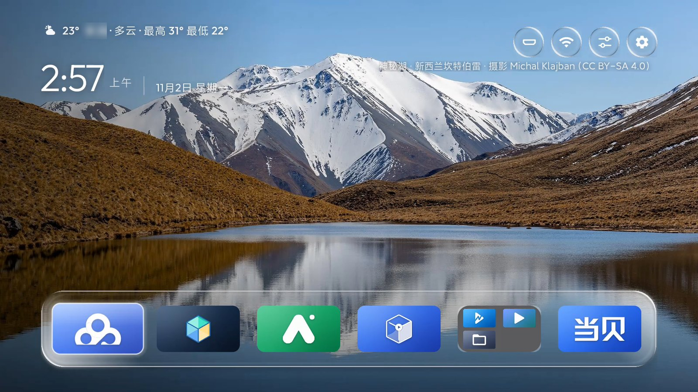
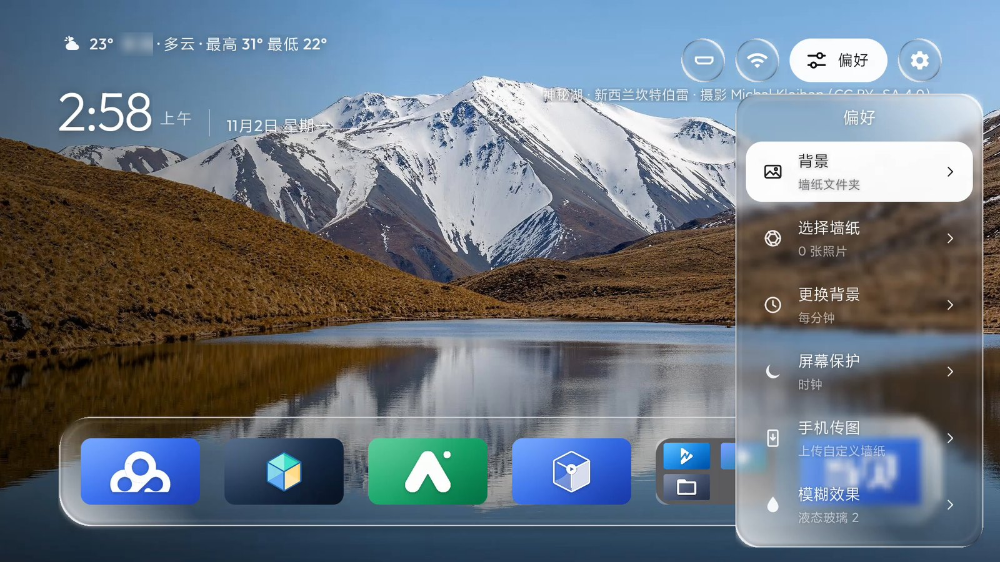
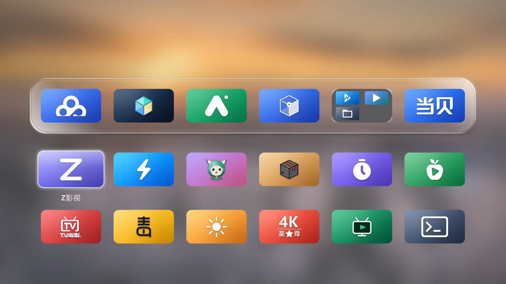

<div align="center">


# AweHome

**A clean, good-looking home screen for your TV.**

A launcher for Android TV: a liquid-glass dock and panels over photos, Bing's picture of the day or Apple TV aerials.<br>
No ads and no recommendation feeds: your apps, the weather and the clock.

[中文](README.md) · **English**

<a href="https://github.com/qingcheng0111/AweHome/releases/latest"></a>
<a href="#install"></a>

<a href="https://github.com/qingcheng0111/AweHome/releases/latest"></a>
<a href="LICENSE"></a>




</div>

## Features

<p align="center">
  
  
</p>

- **Home**: your favourite apps on a glass dock, every app below it; the weather, clock and date at the top left, and four buttons at the top right (Inputs, Wi-Fi, Preferences, Settings). The focused button opens up to show its name.
- **Glass**: frosted glass, liquid glass, liquid glass with plain text, and Liquid Glass 2 (clear glass with lit edges), switched together for the dock, the buttons and the panels. Over a video background the glass follows the picture live.
- **Background**: built-in photos, Bing's picture of the day, stills from popular shows, a wallpaper folder you fill from your phone, colour gradients, or Apple TV aerial films by category (landscapes, cities, space, underwater), changing as often as you like.
- **Screensaver**: a clock, photos or aerial video, opened with Back on the home screen.
- **Preferences panel**: everything is set on the TV and applies at once, without a flicker: 4, 5 or 6 icons a row, a second row on the home screen, the dock's background and titles, a dock that always stays, key sounds, the weather and its city, an app to open at start-up, and names for the inputs.
- **Organise**: hold OK for a menu to add an app to the dock, move it one step in any direction, put it in a folder or open its app info; folders and a hidden folder.
- **Inputs**: name each HDMI port (13 presets such as Apple TV, PlayStation and Switch, or your own), plus casting, TV, DTMB, AV and USB; on Xiaomi TVs each one switches straight to its port.
- **From your phone**: scan the code on the TV to upload wallpapers, change app icons or set the weather city.
- **Tile art**: most Chinese apps ship no TV banner, so you can push your own 16:9 tile pictures (that is how the tiles in these screenshots were made); see [docs/THEMES.md](docs/THEMES.md#磁贴图).
- **Languages**: Simplified Chinese, Traditional Chinese, English, Japanese, Korean and Spanish, switched at once.

## Install

AweHome needs an Android TV, TV box or projector on **Android 8.0 or newer**. No root, no system app is uninstalled, and it can be undone at any time. Your computer and the TV must be on the same network.

1. **Turn on ADB on the TV**: Settings → Device Preferences → About → press Build seven times, then turn on USB debugging in Developer options (Xiaomi and TCL sets: see [the Chinese README](README.md#1-打开电视的-adb-调试)). The TV's IP address is under Settings → Network. TVs with only Wireless debugging (Android 11+) need pairing first: see [docs/INSTALL.md](docs/INSTALL.md#连接电视).
2. **Install and make it Home**: download the latest `AweHome-<version>.apk` from [Releases](https://github.com/qingcheng0111/AweHome/releases/latest), then:

```bash
adb connect 192.168.1.50:5555
adb install -r AweHome-1.1.0.apk
adb shell cmd package set-home-activity --user 0 com.gathin.tvhome/.MainActivity
adb shell am start -a android.intent.action.MAIN -c android.intent.category.HOME -n com.gathin.tvhome/.MainActivity
```

Press Home on the remote: it now opens AweHome. If Android asks which app to use, pick Home (AweHome's name in the system) and then Always. The TV's own launcher stays enabled, in the app list. Many Chinese TVs lock the Home key to their own launcher; there AweHome opens from the app list ([docs/INSTALL.md](docs/INSTALL.md)).

**Update**: from 1.1.1, Preferences → Check now downloads a newer release and opens the TV's installer. Where the TV does not let apps install apps, download the new APK and run `adb install -r` again. Settings, layout and folders stay either way.

**Undo**: `adb shell cmd package set-home-activity --user 0 <stock launcher component>`, then `adb uninstall com.gathin.tvhome` if you want it gone.

## Development

JDK 17 and Android SDK 34 (platform 34, build-tools 34.0.0).

```bash
cd launcher
./gradlew testReleaseUnitTest lintRelease assembleRelease
python3 -m venv ../tools/venv && ../tools/venv/bin/pip install -r ../tools/requirements.txt
TV_HOST=<tv ip> STOCK_LAUNCHER=none ./build-and-install.sh   # build, install and make it Home, stock launcher left alone
```

Code map: [docs/ARCHITECTURE.md](docs/ARCHITECTURE.md). Building, version numbers and releases: [docs/DEVELOPMENT.md](docs/DEVELOPMENT.md). Themes: [docs/THEMES.md](docs/THEMES.md). For AI agents: [AGENTS.md](AGENTS.md). The docs are in Chinese.

## Credits and licence

[MIT](LICENSE). AweHome is built on the launcher from [cleanyourtv](https://github.com/Gathin23/cleanyourtv), with the weather, phone uploads, key sounds and more ported from [aerial-tv](https://github.com/pengchujin/aerial-tv) and the liquid glass ported from [liquid-glass-react](https://github.com/rdev/liquid-glass-react), all MIT. The built-in photos are from Wikimedia Commons (CC BY / CC BY-SA). Every source of fonts, pictures and data is in [NOTICE.md](NOTICE.md).

AweHome is an independent open-source project, not affiliated with Apple, Google, Xiaomi, TCL or any other company. The aerial films are Apple's and stream from Apple's servers; the daily pictures come from Bing.
