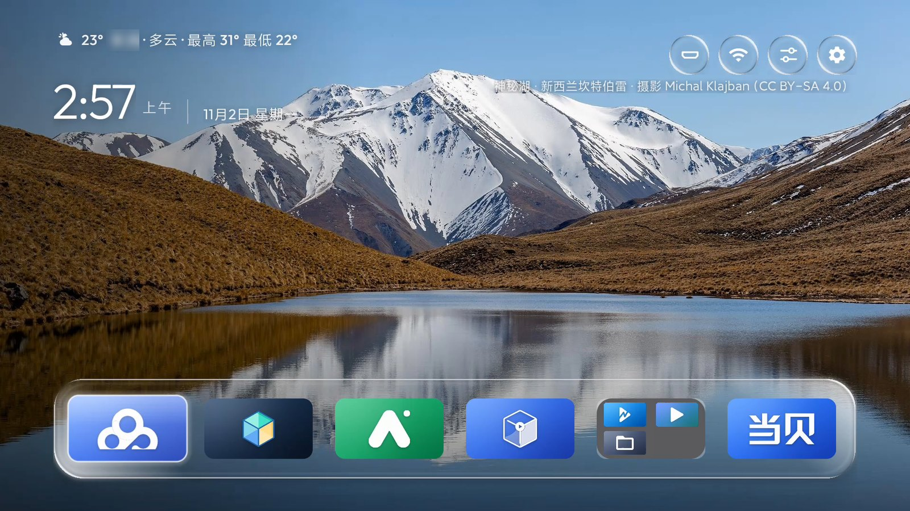
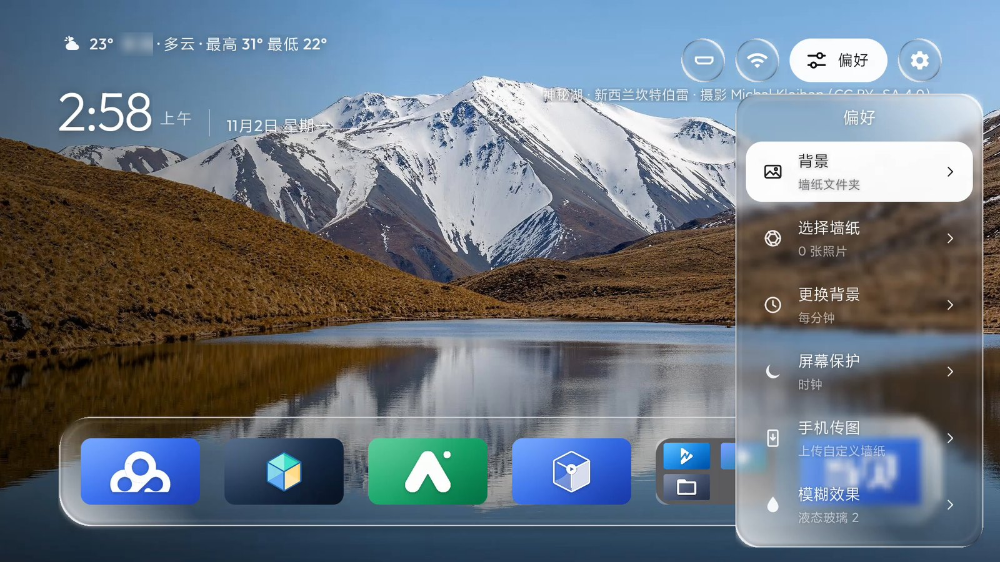
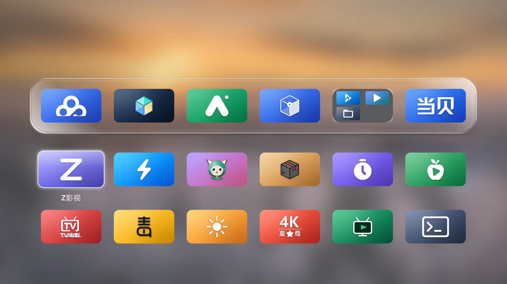

<div align="center">


# AweHome

**一块好看、干净的电视桌面。**

给 Android TV 做的桌面：液态玻璃的程序坞和面板，背后是照片、必应精选或 Apple TV 航拍影片。<br>
没有广告和推荐流，只有你的 App、天气和时钟。

**中文** · [English](README.en.md)

<a href="https://github.com/qingcheng0111/AweHome/releases/latest"></a>
<a href="#安装"></a>

<a href="https://github.com/qingcheng0111/AweHome/releases/latest"></a>
<a href="LICENSE"></a>




</div>

## 功能

<p align="center">
  
  
</p>

- **首页**：常用的一排 App 放在玻璃程序坞上，往下是全部 App；左上角是天气、时钟和日期，右上角是信号源、Wi‑Fi、偏好、设置四个按钮，焦点到哪个按钮，哪个就展开显示文字。
- **玻璃效果**：磨砂玻璃、液态玻璃、液态玻璃 + 普通字体、液态玻璃 2（清透玻璃，只有边缘高光）四种，程序坞、按钮和面板统一切换。背景是视频时，玻璃跟着画面实时流动。
- **背景**：内置照片、必应每日精选、热门影视剧照、墙纸文件夹（用手机扫码上传）、纯色渐变，或者 Apple TV 航拍影片（按风景、城市、太空、水下选分类）。可以设置多久换一张。
- **屏保**：时钟、图片、航拍视频三种，在首页按返回键打开。
- **偏好面板**：所有设置都在电视上改，改完立即生效、不闪屏：每行 4 / 5 / 6 个图标、是否露出第二排、程序坞背景和标题、程序坞常驻、按键声音、桌面天气和城市、开机自启的 App、信号源名称。
- **整理**：长按 OK 键打开菜单，添加到程序坞、上下左右移一格、移到文件夹、查看应用信息；支持文件夹和隐藏文件夹。
- **信号源**：给每个 HDMI 口起名字（Apple TV、PlayStation、Switch 等 13 种预设，也可以自己输入），列表里还有投屏、TV、DTMB、AV、USB；小米电视上能直接切到对应的口。
- **手机传图**：扫电视上的二维码，用手机上传墙纸、换 App 图标、设置天气城市。
- **磁贴图**：国产 App 大多没有给电视设计的横幅，可以给它们推送自己做的 16:9 磁贴图（截图里的磁贴就是这样换的），见[主题文档](docs/THEMES.md#磁贴图)。
- **语言**：简体中文、繁體中文、English、日本語、한국어、Español，切换后立即生效。

## 安装

需要 **Android 8.0 及以上**的 Android TV、电视盒子或投影仪。不用 root，不卸载任何系统应用，随时能还原。电脑和电视要连同一个网络。

### 1. 打开电视的 ADB 调试

| 电视 | 怎么打开 |
|---|---|
| **小米 / Redmi** | 设置 → 关于 → 连续按「产品型号」进入开发者模式，再到 设置 → 账号与安全，打开「ADB 调试」和「安装未知来源的应用」 |
| **TCL / 雷鸟** | 设置 → 关于 → 本机信息，快速按遥控器「上下左右」，在底部的「更多」里打开 ADB |
| **其他 Android TV** | 设置 → 设备偏好设置 → 关于 → 连按「内部版本号」7 次，再在开发者选项里打开「USB 调试」 |

电视的 IP 在「设置 → 网络」里。第一次连接时电视会问是否允许调试，选「始终允许」。只有「无线调试」的 Android 11 及以上电视，要先配对，见[安装说明](docs/INSTALL.md#连接电视)。

### 2. 安装并设为桌面

从 [Releases](https://github.com/qingcheng0111/AweHome/releases/latest) 下载最新的 `AweHome-<版本>.apk`，然后在电脑上运行（把 IP 换成你的电视）：

```bash
adb connect 192.168.1.50:5555
adb install -r AweHome-1.1.0.apk
adb shell cmd package set-home-activity --user 0 com.gathin.tvhome/.MainActivity
adb shell am start -a android.intent.action.MAIN -c android.intent.category.HOME -n com.gathin.tvhome/.MainActivity
```

装好后按遥控器的主页键，回到的就是 AweHome。系统问「使用哪个应用」时选「主屏幕」（AweHome 在系统里的名字，英文系统里叫 Home），再选「始终」。电视原来的桌面没有被停用，还在应用列表里。

国产电视大多把主页键锁在自家桌面上，这时 AweHome 只能从应用列表打开。各种情况的处理见[安装说明](docs/INSTALL.md)。

**U 盘**：把 APK 拷进 U 盘，用电视的文件管理器打开安装，再按主页键选「主屏幕」。

**从源码装**：见下面的[开发](#开发)，`launcher/build-and-install.sh` 会编译、安装并设为桌面。

### 升级

1.1.1 起，打开 偏好 → 立即检查，有新版本时选它就会下载，并用电视自己的安装器安装。电视不让 App 安装应用时，下载新版 APK 再运行一次 `adb install -r`。两种方式都会保留设置、布局和文件夹。

### 还原

```bash
adb shell cmd package set-home-activity --user 0 <原来的桌面包名>/<它的 Activity>
adb uninstall com.gathin.tvhome   # 不想留着 AweHome 时再卸载
```

不知道原来的桌面是哪个，见[安装说明的「还原」](docs/INSTALL.md#还原)。

## 实测过的机型

| 机型 | 系统 | 情况 |
|---|---|---|
| Redmi 电视 MiTV-MFTP0 | Android 9 | ✅ 日常使用，上面的截图就是在这台电视上拍的（[笔记](docs/devices/xiaomi-mitv-mftp0.md)） |
| Android TV 模拟器（1080p） | Android 9 | ✅ 开发时用 |

你的电视能用或者有问题，欢迎用 [Issues](https://github.com/qingcheng0111/AweHome/issues/new/choose) 告诉我。

## 开发

需要 JDK 17、Android SDK 34（platform 34、build-tools 34.0.0）。

```bash
cd launcher
./gradlew testReleaseUnitTest lintRelease assembleRelease   # 产物在 app/build/outputs/apk/release/
python3 -m venv ../tools/venv && ../tools/venv/bin/pip install -r ../tools/requirements.txt
TV_HOST=<电视IP> STOCK_LAUNCHER=none ./build-and-install.sh   # 编译、安装、设为桌面，不停用原桌面
```

- 代码结构和每个功能在哪个文件：[docs/ARCHITECTURE.md](docs/ARCHITECTURE.md)
- 构建、版本号规则和发版：[docs/DEVELOPMENT.md](docs/DEVELOPMENT.md)
- 主题（`config.json`、壁纸合集）：[docs/THEMES.md](docs/THEMES.md)
- 给 AI 代理的说明：[AGENTS.md](AGENTS.md)

## 致谢与许可

[MIT](LICENSE)。AweHome 以 [cleanyourtv](https://github.com/Gathin23/cleanyourtv) 的桌面为底层，天气、手机传图、按键声音等移植自 [aerial-tv](https://github.com/pengchujin/aerial-tv)，液态玻璃移植自 [liquid-glass-react](https://github.com/rdev/liquid-glass-react)，三者都是 MIT。内置照片来自 Wikimedia Commons（CC BY / CC BY-SA）。字体、图片和数据的完整来源见 [NOTICE.md](NOTICE.md)。

AweHome 是独立的开源项目，与 Apple、Google、小米、TCL 等公司无关。航拍影片版权归 Apple，由 Apple 的服务器直接播放；每日精选图片来自必应。
